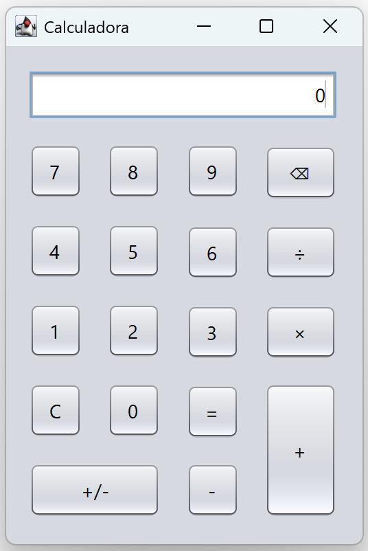

## Sobre o Projeto

Desenvolvimento de uma calculadora em Java com interface gráfica, capaz de realizar as quatro operações matemáticas básicas: adição, subtração, multiplicação e divisão.

O projeto foi desenvolvido como trabalho final da disciplina de **Programação Orientada a Objetos**, utilizando a IDE **Apache NetBeans**.

### Requisitos e Funcionalidades

- Interface gráfica semelhante à de uma calculadora convencional;
- Botões individuais para os números de 0 a 9;
- Botões individuais para as quatro operações matemáticas básicas (adição, subtração, multiplicação e divisão);
- Botão de igualdade (`=` ou `ENTER`) para executar os cálculos;
- Botão de reset (`RESET`) para limpar os valores e reiniciar os cálculos;
- Display para exibição dos números e resultados das operações.

### Regras de Funcionamento

- Realizar as quatro operações básicas utilizando exclusivamente números inteiros de até três dígitos;
- Exibir os resultados tanto no display da interface gráfica quanto no terminal (console);
- Apresentar apenas a parte inteira do resultado das divisões;
- Permitir que o display exiba mais de três dígitos quando o resultado da operação ultrapassar esse limite;
- Preservar o resultado exibido no display para que possa ser utilizado como valor na operação seguinte.

## Interface da Calculadora

  

